<h3 align="center">Striving to build projects with real-world impact. Currently exploring ML & computer vision :)</h3>

## My Toolkit

- **Languages:** Python, TypeScript, Java, C/C++, Swift, SQL, R, Swift
- **Building:** React Native, Expo, Next.js, Supabase, Vercel, SwiftUI, Git, GitHub Actions
- **ML & AI:** scikit-learn, pandas, OpenCV, MediaPipe, Gemini API, pgvector
- **Design:** Figma, Canva

## Watch My Snake for Me?

  <picture>
    <source media="(prefers-color-scheme: dark)" srcset="https://raw.githubusercontent.com/sarah-vanvelzer/sarah-vanvelzer/output/snake-dark.svg">
    <source media="(prefers-color-scheme: light)" srcset="https://raw.githubusercontent.com/sarah-vanvelzer/sarah-vanvelzer/output/snake-light.svg">
    
  </picture>

Thanks for visiting!

