  I build projects with real-world impact, and lately I'm learning computer vision & ML one weekend project at a time :)

## My Toolkit

- **Languages:** Python, TypeScript, Java, C/C++, Swift, SQL, R
- **Building:** React Native, Expo, Next.js, Supabase, SwiftUI, Git
- **ML & computer vision:** scikit-learn, pandas, OpenCV, MediaPipe
- **Design:** Figma, Canva

## Watch My Snake Eat My Commits

  <picture>
    <source media="(prefers-color-scheme: dark)" srcset="https://raw.githubusercontent.com/sarah-vanvelzer/sarah-vanvelzer/output/snake-dark.svg">
    <source media="(prefers-color-scheme: light)" srcset="https://raw.githubusercontent.com/sarah-vanvelzer/sarah-vanvelzer/output/snake-light.svg">
    
  </picture>

Thanks for visiting!

